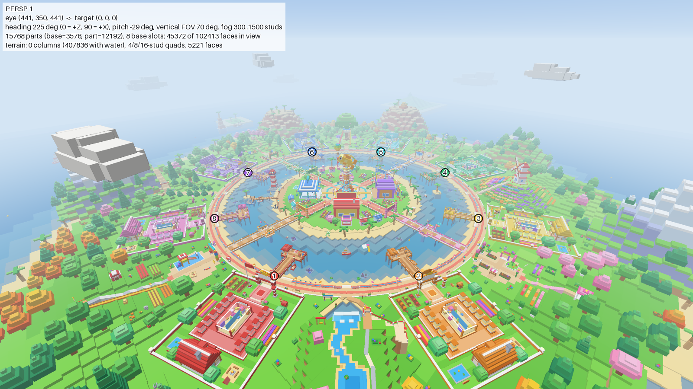
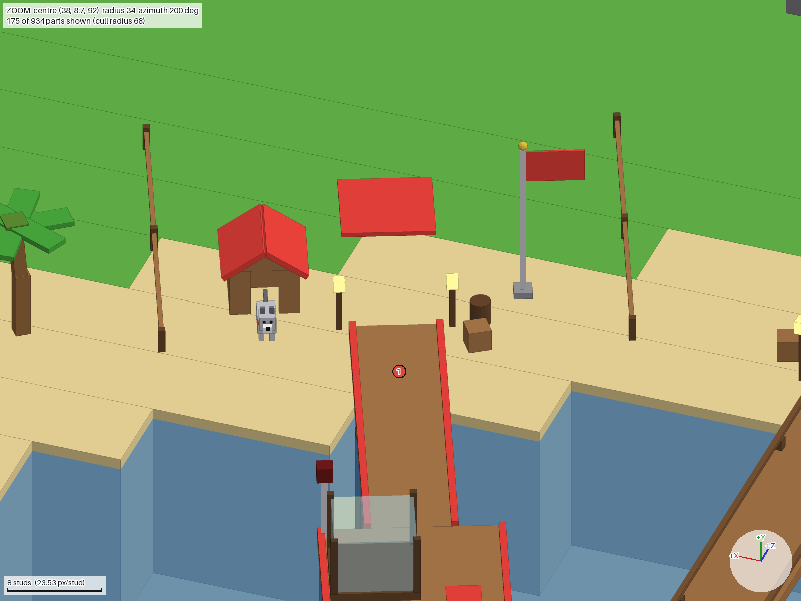
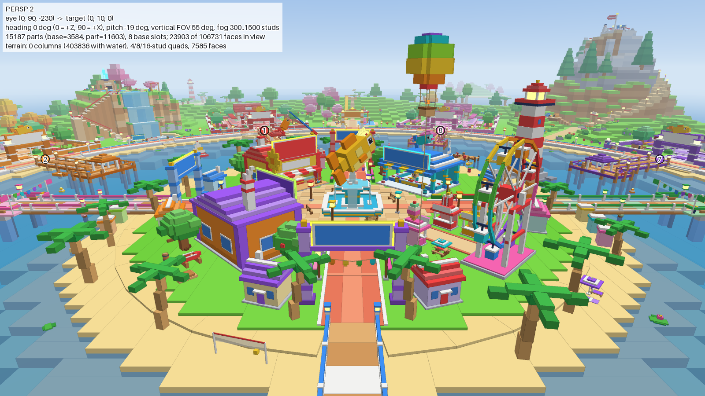

# Рыбалка + кража — MVP для Roblox

**Открывай `Place1.rbxl` в Roblox Studio — всё внутри файла:** карта, шаблон базы, скрипты, интерфейс, RemoteEvent'ы.
Rojo не нужен. Папки `src/` и `tools/` — исходники и сборщик, из которых собирается этот файл
(для истории изменений и автопроверок); тебе они не нужны.

| Карта | База | Остров-деревня |
|---|---|---|
|  |  |  |

<sub>Превью отрисованы прямо из `Place1.rbxl` скриптом `tools/preview` (в игре вода — настоящая вода Terrain с волнами).</sub>

## Мир «Остров Рыбаков»

Воксельный атолл в стиле топовых симуляторов (Steal a Brainrot, Grow a Garden): вся земля собрана из
блоков — травяные террасы, песчаные пляжи, скалы, снежные вершины; вода — бирюзовая вода Terrain.
Палитра — сочная, но гармоничная (натуральные материалы + небольшие яркие акценты: цветы, флаги, навесы,
крыши в цвете базы); все цвета карты собраны в `tools/builder/Palette.luau`.
Всё как из **LEGO**: на верхних гранях блоков (газоны, песок, пирсы, палубы, дорожки, площади, плоские
крыши, верхушки крон, столы и скамьи от 2 × 2) — круглые шипы, снизу — гнёзда; стены, скаты крыш,
брёвна, вода, стекло, неон и мелкие детали — гладкие. Это родные поверхности Roblox (материал Plastic +
`Studs`/`Inlet`): без загруженных текстур и лишних деталей, на телефоне шипы остаются чёткими.

- **Лагуна** (радиус ~300 studs) с **островом-деревней** в центре (радиус 150): площадь с башней «Золотая рыбка»,
  фахверковые магазины «Удочки», «Рыбный рынок», «Мастерская», домики рыбаков с двориками, ярмарка
  (колесо обозрения, карусель), пляж с кафе и купальнями, гавань с маяком.
- **4 моста** на остров и **прогулочное кольцо** вдоль лагуны — по нему можно добежать до любой базы.
- **8 больших баз** (участок 136 × 150 + свой пирс 92 studs): дом рыбака с башней-смотровой, аквариум и
  12 витрин под тремя павильонами с каждой стороны, фонтан с рыбой, пруд с мальками, огород, коптильня,
  сарай со снастями, сирена, флаг с именем владельца, ворота с табличкой. Цвет базы — на крышах, флаге и
  вывесках; тон стен дома у каждой базы свой. Собака невидима, пока игрок не купит её (Этап 4).
- **Холмы с лесами** и достопримечательностями: водопад со скалы с лестницей на смотровую площадку, мельница на
  ступенчатом холме с цветочными террасами, гигантское дерево с домиком, снежная вершина с тропой (+ ещё пять гор),
  4 района у мостов (рыбацкий ряд, ферма, сады с оранжереей, лесной лагерь) со своими площадями.
- **Океан до горизонта**: островки с маячком, руинами и хижиной рыбака, затонувший корабль, лодки, облака.
- **Мелкие детали**: на пирсе — фонари по краям заброса, ящик со снастями, табурет, ловушки, сеть с
  поплавками, вяленая рыба, флажки, флюгер-«колбаса», колокольчики из ракушек; у каждой базы своя сценка
  (крабовые ловушки, сеть, цветы на перилах или якорь). На берегу — пена прибоя и мокрый песок, замки из
  песка, зонтики с полотенцами, коряги, ракушки, бутылка с запиской, камыш; в лагуне — линии красно-белых
  поплавков, плавающие ящики, кувшинки, водоросли и сундуки на дне. На кольце — тумбы, кашпо на фонарях,
  урны и указатели «МОСТ →»; на площади острова — столики кафе, бочки с цветами, указатели к магазинам.
  Флаги, вымпелы, гирлянды, пальмы, камыш и водоросли помечены для покачивания (анимация — следующий этап).

## Что внутри Place1.rbxl

```
Workspace
  Terrain                  только вода: лагуна, пруд у водопада, океан
  Map
    BaseSlots              8 невидимых меток: где встанут базы (атрибут Index)
    Ground                 земля из блоков (Locked — случайно не сдвинешь)
    Hub                    остров-деревня: Shop, FishMarket, Workshop, фонтан, маяк, колесо обозрения, HubSpawn
    Bridges, Promenade     мосты на остров и прогулочное кольцо вдоль лагуны
    Gateways, Landmarks    площади у мостов; водопад, мельница, гигантское дерево, вершины
    Nature                 леса, кусты, цветы, камни
    Lagoon, Ocean, Sky     лодки, буйки, плавучие домики; островки, корабль; облака
    Shore                  пена и мокрый песок у кромки воды, пляжные сценки, поплавки, водоросли, сундуки
    Boundaries             невидимая стена в океане
  Bases                    (появляется в игре) Base_1 … Base_8 — клоны шаблона
ServerStorage
  BaseTemplate             ОДНА база-шаблон: аквариум + 12 витрин, дом, собака (скрыта), сирена, флаг, ворота, пирс
ReplicatedStorage
  Shared
    Config                 ← ЧИСЛА БАЛАНСА: BaseConfig, UIConfig, FishConfig (рыбы, редкости, мутации),
                             RodConfig (удочки), FishingConfig (время, расстояния, сложность мини-игры)
                             MapConfig — раскладка мира (для сборщика, см. комментарий внутри)
    FishingRules           правила рыбалки, общие для сервера и клиента (шансы, стрелка мини-игры, цена)
    Util                   Signal, Trove (уборка соединений), Cooldown
    Net, RemoteNames       доступ к RemoteEvent'ам и их список
  Remotes                  RemoteEvent / RemoteFunction
  Assets                   готовые модели: Rods (удочки-Tool), Bobbers (поплавки), Fish (6 рыб × 4 вида:
                           обычная, Gold, Neon, Rainbow)
ServerScriptService
  Main                     точка входа сервера: Init/Start всех сервисов по порядку
  Services                 MapService (проверка воды), BaseService (базы), FishingService (рыбалка)
  Lib/Notify               уведомления игрокам
StarterPlayer.StarterPlayerScripts
  ClientMain               точка входа клиента
  Controllers              NotifyController, HudController, FishingController (кнопки и мини-игра),
                           FishingFxController (поплавки и лески всех игроков), FisherAnimController
                           (тело рыбаков: замах, борьба, рыба над головой; гнущаяся удочка; помощники
                           FisherRig, FisherPoses — позы и тайминги, FisherRod), AmbientController (рыбы, чайки…)
StarterGui
  HUD                      интерфейс (всё в Scale, под телефоны, ландшафтная ориентация)
```

## План этапов

| Этап | Что | Статус |
|---|---|---|
| 1 | Шаблон базы, 8 клонов с цветами, выдача/освобождение баз, очередь, спаун на базе, «Домой» | ✅ готово |
| 2 | Удочка, заброс, поклёвка, мини-игра на тайминг, конфиг рыб, редкости, мутации | ✅ готово |
| 3 | Садок (слоты), доход в секунду, рост стоимости, продажа, DataStore | ⏳ |
| 4 | Кража (удержание 3 с), уведомление + мигающая лампа, собака, замок, щит | ⏳ |
| 5 | Магазин и 3 улучшения, доработка интерфейса | ⏳ |

## Как проверить Этап 1

1. Открой `Place1.rbxl` в Studio → **Play** (F5).
   - В Output: `[MapService] вода на месте`, `[BaseService] создано баз: 8`, `[Main] сервер запущен`.
   - Ты появляешься на цветной площадке **своей** базы, лицом к лагуне. Посередине экрана — уведомление «Твоя база — …!».
   - Вверху по центру — плашка с цветом и названием базы. Над флагом и на воротах базы — твоё имя.
   - Лагуна — настоящая вода, в ней можно плавать; на пляж, пирс и остров можно выбраться.
2. Выйди через ворота базы на прогулочное кольцо, дойди до ближайшего моста и по нему — на остров-деревню.
   Нажми **ДОМОЙ** справа — телепорт на базу, кнопка темнеет на 5 секунд.
   Погуляй: пирс своей базы, соседние базы по кольцу, площади у мостов, водопад (лестница на скалу),
   мельница на холме, гигантское дерево, снежная вершина. Все холмы — ступеньки по 4 studs, на них можно запрыгнуть.
3. Меню (Esc) → **Reset Character** → через 3 секунды возрождаешься снова на своей базе.
4. Мультиплеер: вкладка **Test**, режим **Server & Clients** (в старом меню — «Clients and Servers → Local Server»),
   2–3 игрока → **Start**.
   - У каждого своя база и свой цвет, на табличках над флагами — имена.
   - Закрой окно одного клиента → его база снова «Свободно».
5. Очередь ожидания (Studio запускает максимум 8 клиентов, поэтому уменьшим число баз):
   - в `ReplicatedStorage.Shared.Config.BaseConfig` поставь `MaxBases = 2`, запусти **Server & Clients на 3 игрока**;
   - третий игрок видит «Все базы заняты — ждём свободную», на плашке «Ждём базу…», стоит на хабе, кнопки «Домой» нет;
   - закрой первого или второго клиента → третий сразу получает освободившуюся базу и переносится на неё;
   - верни `MaxBases = nil`.

Совет: перед публикацией выставь в Game Settings максимум **8 игроков** на сервер (по числу баз).

## Как проверить Этап 2 (рыбалка)

1. **Play** (F5). Внизу экрана, в панели предметов, — «Бамбуковая удочка», над ней подсказка
   «Иди в сверкающий круг на краю пирса».
2. Пройди по своему пирсу до конца: на краю платформы — **сверкающий круг**. Встань в него — справа
   появится оранжевая кнопка с удочкой **ВЗЯТЬ** (или возьми удочку из панели предметов: клавиша 1).
   - Если взять удочку вдали от пирса, кнопка станет серой «КУДА ИДТИ?» 🧭 (нажатие не забрасывает и не
     ругает, а отвечает на вопрос — показывает дорогу: компас крутится, луч вспыхивает, спокойная
     подсказка 💡 «Иди в сверкающий круг на краю пирса»), внизу — жёлтый луч-дорожка к кругу. Идёшь сам.
3. **ЗАБРОСИТЬ** — большая кнопка слева от кнопки прыжка (на ПК ещё клик мышью или клавиша **F** —
   она нарисована на «клавише» у кнопки; на геймпаде R2). Рыбак сразу замахивается — удочка уходит
   за голову, поплавок висит на её кончике, — через 0,3 с хлёстко бросает (удочка гнётся и
   пружинит), поплавок срывается с кончика и летит по дуге в воду, от кончика тянется леска. Тело
   рыбака двигается всю рыбалку (подробнее — пункт 11). Кнопка становится голубой «ЖДЁМ…» с покачивающимся поплавком (рыба
   разок-другой «пробует» наживку — кнопка вздрагивает, всплывает «?», поплавок в воде заметно
   притапливается, над ним мелькает «?»), над ней — «СМОТАТЬ» (смотать леску, пока не клюнуло).
4. Через 2,5–6 секунд **клюёт**: поплавок дёргается, брызги, «!» над ним, внизу оранжевое
   «КЛЮЁТ!» с тающей полоской (плашка не закрывает ныряющий поплавок), края экрана светятся,
   кнопка «ПОДСЕЧЬ!» пульсирует в такт; в первые две поклёвки на неё показывает 👆, на телефоне
   можно тапнуть и по самой плашке «КЛЮЁТ!». «СМОТАТЬ» пока рыба на крючке прячется (случайный тап
   мимо не стоит рыбы). На подсечку — 1,8 секунды (если не нажать вовремя — «Слишком поздно — рыба
   уплыла»).
5. **Мини-игра**: сверху название редкости её цветом («ОБЫЧНАЯ РЫБА!» … «МИФИЧЕСКАЯ РЫБА!»; у
   легендарной и мифической над панелью ещё и огромное слово «ЛЕГЕНДАРНАЯ!» / «МИФИЧЕСКАЯ!» — первое же
   слово попадания или промаха его сбивает, два слова друг на друге не стоят), по
   полосе бегает белая стрелка ▼, на зелёной зоне сидит рыбка — по редкости 🐟 🐠 🐡 🦈 🐉 (редкая —
   с лёгкой голубой обводкой панели, эпическая и выше — с цветной). На телефоне панель встаёт рядом
   с поплавком, чтобы было видно, как рыба его дёргает. Жми **ЛОВИ!** (или F / клик; на телефоне
   можно тапнуть и по самой панели), когда стрелка в **зелёной зоне**. Чем рыба реже, тем уже зона и
   быстрее стрелка; эпической и легендарной нужно 2 попадания подряд, мифической — 3 (кружки справа
   внизу панели), после каждого попадания зона прыгает в другое место («ОТЛИЧНО!», «СУПЕР!», в центр зоны —
   «ИДЕАЛЬНО!»). Промах — «Мимо! Рыба сорвалась с крючка»; на всё — 12 секунд (полоска с ⏱).
6. **Улов**: победное нажатие «замораживает» стрелку золотой там, где ты нажал, — до ответа сервера.
   Потом мини-игра вспыхивает золотом и уходит вниз, левее персонажа «впечатывается» крупное
   «ПОЙМАНА!» цвета редкости (и тает чуть раньше приземления — перед ударом миг тишины), плашка
   сверху и счётчик гаснут, а рыба выпрыгивает у поплавка и дугой летит тебе над голову. У эпической
   и выше по краям экрана нарастает узкая цветная рамка (у мифической — светлая радуга бежит по
   кругу), у легендарной и мифической ещё всё чаще бьётся «сердце» и камера чуть отъезжает; в миг
   приземления рамка обрывается. Экран **не заливается вспышкой**: из рыбы расходятся кольца-волна и
   искры, камера «вздрагивает», конфетти, у легендарной и мифической края экрана на миг вспыхивают
   узкой полосой. У эпической и выше из-за рыбы бьют лучи (саму рыбу видно), под ней почти секунду
   стоит огромное слово редкости — буквы белое → золото (у мифической — радуга), влетают по одной,
   качаются волной, по слову пробегает белый блик, а экран вокруг чуть темнеет. Потом карточка
   «вырастает» из рыбы (слово улетает в её баннер, баннер вырастает из него, и надпись баннера
   проявляется, пока слово тает): на телефоне — широкая «трофейная» (рыба слева, имя и цена справа; посередине экрана),
   на ПК и планшете — квадратная; у легендарной и мифической карточка крупнее. Редкость видна по
   самой карточке: лучики за рыбой, у эпической и выше — «живая» рамка (фиолетовая дышит, по
   золотой бежит блик, у мифической вращается радуга), у легендарной и мифической лицо карточки
   в цвет редкости. Имя появляется вместе с карточкой (въезжает справа), дальше по очереди, с
   паузами (у обычной и редкой — бодро, у эпической и выше — чуть торжественнее), — «НОВИНКА!»
   (первая такая рыба за игру), вес и цена; цена (самое крупное число карточки) набегает до самого
   конца и «приземляется» с пружинкой, и из неё вылетает крупное золотое «+590 💰» — в свободное
   место справа от карточки, саму цену оно не закрывает (у легендарной и мифической ещё сыплются 💰
   по бокам от карточки). Новая обычная или редкая рыба — маленький праздник: у «НОВИНКИ!» искры,
   конфетти и «дзынь», лучи ярче, «+N 💰»; знакомая обычная — спокойно. У мутации цена сперва
   «дышит», потом штамп на рыбе, «×N» к цене и пересчёт — и тогда уже праздник у полной цены. В
   конце на карточке «Тапни — забрать!», а большая кнопка становится зелёной «ЗАБРАТЬ!» 👍 с белым
   ореолом (мифическая карточка ещё мягко «дышит»). Тап по карточке раньше конца — показать всё
   сразу, следующий тап (не раньше чем через 0,6 секунды) — закрыть. Кнопка действия (и F / R2)
   показ не пропускает: если жать её без остановки после «ЛОВИ!», карточка спокойно доиграет и
   останется; закрывает её только нажатие на «ЗАБРАТЬ!» после короткой паузы. Сама карточка
   закрывается через 2–5 секунд (чем реже рыба, тем дольше). Закрываясь, она сама улетает в
   счётчик «Улов: N», сжимаясь в точку (первая рыба за игру — счётчик появляется с «Улов: 0»), рядом
   с ней летит 🐟 со звёздочками цвета редкости, и примерно через треть секунды после тапа счётчик
   встречает их кольцом и «+1» того же цвета, а следом рыба над головой ещё раз «вспыхивает» (на ПК
   и планшете у легендарной и мифической — ещё коротким столбом света) и только теперь рядом с ней
   выскакивает табличка с названием и ценой (пока была карточка, её не было: она повторяла бы
   карточку). Рыба висит ещё около 3 секунд — всего 7–10 секунд по редкости (её видят все; у других
   табличка над рыбой с самого приземления). Кнопка 0,8 секунды тусклая, потом снова «ЗАБРОСИТЬ».
7. **Шансы** (с бамбуковой удочкой): Карасик 35 %, Окунь-полосатик 25 %, Фугу-пуфик 25 %, Меч-рыба 10 %,
   Акулёнок 4 %, Рыба-дракон 1 %. Мутации: золотая ×2 к цене (6 %), неоновая ×3 (3 %), радужная ×5 (1 %,
   переливается). Чтобы быстро посмотреть редкую рыбу или мутацию, временно поменяй числа в
   `ReplicatedStorage.Shared.Config.FishConfig` — например `Weight = 1000` у редкости Mythic или
   `Chance = 0.9` у мутации Rainbow — и запусти Play (потом верни как было).
8. **Сервер решает сам**: на чужом пирсе заброс не принимается («Иди в сверкающий круг на краю пирса»); если во время рыбалки отойти от круга дальше ~18 studs, убрать удочку или умереть —
   леска сматывается. Рыбу выбирает и попадание в зону проверяет сервер, клиент только просит.
9. **Мультиплеер** (Server & Clients, 2 игрока): каждый рыбачит со своего пирса и видит поплавок и леску
   соседа и рыбу у него над головой; о легендарной и мифической рыбе остальным — в тот миг, когда
   рыба долетела и над соседом встал столб света (издалека он шире, выше — луч в небо с любого
   пирса — и горит дольше; вблизи начинается над его табличкой), — приходит объявление в две
   строки: мелко «Вася (Лазурная база)», крупно золотом «ЛЕГЕНДАРНАЯ золотая рыба «Акулёнок» ×2!» (у
   мифической — бегущая радуга и радужные края экрана). Если столба не видно (он за спиной или за
   краем экрана), у края экрана с его стороны, пока он горит, висит маленький значок 🌟 / 🌈 в кольце
   цвета базы соседа, острым краем к столбу; повернул камеру к столбу — значок исчезает.
10. **Телефон**: вкладка Test → эмулятор устройств (иконка телефона) → любой телефон в альбомной
    ориентации. Кнопка «ЗАБРОСИТЬ» — слева от кнопки прыжка, мини-игра и подсказки — над панелью
    предметов; в мини-игре считаются только нажатия на кнопку (движения камерой не мешают), и так
    же на экране улова и с кнопкой «КУДА ИДТИ?»: поворот камеры пальцем не закрывает карточку и не
    забрасывает. Уведомления на телефоне и планшете — по одному, над головой персонажа; пока идёт
    поклёвка, мини-игра или улов, они ждут и выходят потом (на ПК при мини-игре видно одно, но и
    оно уступает место словам «ОТЛИЧНО!» / «МИМО!», которые поднимаются над панелью).
11. **Анимация рыбака** (свой персонаж и соседи — у каждого игрока на экране одинаково): взял удочку —
    поднял её и глянул на кончик; ждёт — покачивается, дышит, смотрит на поплавок (корпус слегка
    развёрнут к нему), кончик вздрагивает вместе с «примеркой» рыбы; клюёт — вздрогнул, подался
    вперёд, кончик дёргается в такт нырков поплавка; подсечка — рывок удочкой вверх; борьба — упор
    ногами, откинулся, левая рука крутит катушку, удочку сильно гнёт к леске и мотает за поплавком
    (у редкой своей рыбы — сильнее), попадание в мини-игре — рывок; поймал — рывок, смотрит вверх за
    прыжком рыбы, обе руки вверх — ловит её над головой, подпрыгивает и «качает» трофей, держит его
    обеими руками (после карточки улова — ещё одно «качание»); рыба ушла — поник, качает головой.
    Пошёл — корпус и голова сразу возвращаются к обычной ходьбе, руки продолжают держать удочку
    (рыбу над головой — несут). Проверь в Server & Clients на 2 игроках: у соседа всё то же самое.
    Проверь и R6: Game Settings → Avatar → R6 → Play — позы те же (у R6 нет локтей — рука прямая).
    Если анимация когда-нибудь сломается (новое обновление аватаров Roblox), её можно выключить:
    атрибут `FisherAnimOff = true` у своего Player (Studio → Players → игрок → Attributes) или
    `FisherAnimController.Enabled = false`; временный обход для Avatar Joint Upgrade — Game Settings →
    Avatar → AvatarJointUpgrade = Disabled (в файле места не сохраняется).

12. **Шипы LEGO** (ПК и телефон в эмуляторе, Настройки → Графика: 1 и «Авто»): шипы видны на газоне базы,
    на пирсе, на прогулочном кольце и площадях; вблизи у каждого шипа светлая и тёмная сторона.
    На стыках плиток кольца и на перекрёстках дорожек базы ничего не мерцает; под навесами и мостами
    снизу — гнёзда. Удочка, поплавок, рыбы и эффекты (круги на воде, столб света, конфетти) — гладкие.
13. **Мелкие детали**: встань в круг на краю пирса — по бокам кадра два фонаря на столбах, слева ящик со
    снастями (цвета базы) и табурет, справа сценка базы; заброс и поплавок ничем не закрыты, камера за
    спиной ни во что не упирается. Пройди по пирсу: поперечные доски, бухты каната, флажки над входом на
    платформу, флюгер-«колбаса» справа сзади. Сходи на пляж у пирса: у кромки воды — светлая полоса пены и
    тёмная полоса мокрого песка (и на берегу острова), чуть дальше — сценки (замок из песка, зонтик, коряга,
    вертушка, бутылка). Все эти мелочи не мешают ходить (сквозь них можно пройти) и не дают теней.
    Соседние базы отличаются сценкой на платформе (базы 1 и 5, 2 и 6 … одинаковые).

Улов пока хранится до выхода из игры: садок, доход, продажа и сохранение — Этап 3.

## Как редактировать

- **Баланс** — модули в `ReplicatedStorage.Shared.Config`: `FishConfig` (рыбы, шансы, цены, мутации),
  `RodConfig` (5 удочек — пригодятся в магазине на Этапе 5), `FishingConfig` (время поклёвки, расстояния,
  сложность мини-игры для каждой редкости).
- **Модели удочек и рыб** — `ReplicatedStorage.Assets` (собраны из блоков по концептам, `docs/gear`).
- **Шаблон базы** — перетащи `ServerStorage.BaseTemplate` в Workspace, правь, верни обратно.
  Детали, которые красятся в цвет базы, помечены атрибутом `Accent = true`.
  У шаблона должен быть задан `PrimaryPart` (деталь `Root`). Не переименовывай: `SpawnPad`, `FishingSpot`,
  `Tank/Glass/PromptAttachment`, `Tank/Slots/Slot_1…12`, `Alarm/Lamp`, `Dog`,
  `Flag/Pole/SignAttachment/OwnerSign/OwnerLabel` и `.../BaseLabel`
  (их ищет BaseService; если чего-то нет — в Output будет понятная ошибка с именем детали).
  Атрибут `AccentShade` (−1…1) делает деталь светлее/темнее цвета базы.
  Собака (`Dog`) пока невидима (атрибут `Unlocked = false`): она появится, когда игрок купит
  улучшение «Собака» (Этап 4).
- **Где стоят базы** — двигай метки `Workspace.Map.BaseSlots` (сторона −Z метки смотрит в сторону лагуны).
  Земля под участками ровная только на своих местах — при переносе метки учти рельеф.
- **Шипы LEGO** ставит сборка (`tools/builder/Studs.luau`): деталь с шипами — материал Plastic, сверху
  `Studs`, снизу `Inlet`. Новая деталь в Studio по умолчанию тоже Plastic с шипами сверху; гладкая —
  материал SmoothPlastic. В исходниках атрибут `Studs = false` на детали или модели убирает шипы,
  `Studs = true` — ставит (если грань не меньше 2 × 2).
- **Земля** — блоки в `Workspace.Map.Ground` (заблокированы от случайного перетаскивания: сними Locked, если нужно).
  Вода — Terrain: можно править кистями Terrain Editor. Если воду случайно стереть, сервер зальёт её заново.

> ⚠️ **Важно про правки в Studio.** Каждый следующий этап я собираю в новый `Place1.rbxl`.
> Если ты что-то поменял в Studio (числа в Config, шаблон базы, метки, интерфейс) — **пришли мне свой
> `Place1.rbxl` вместе с подтверждением этапа**. Я сравню его с моей версией (`tools/diff_places.luau`),
> перенесу твои правки в исходники, и они сохранятся. Иначе новая версия файла их перезапишет.

## Для разработки (необязательно)

Файл собирается скриптом на [Lune](https://github.com/lune-org/lune) из `src/` + генераторов в `tools/builder/`:

```bash
lune run tools/build.luau                     # tools/base/Place1.base.rbxl + src/ → Place1.rbxl (+ самопроверка)
tools/analyze.sh                              # проверка типов по настоящему API Roblox (luau-lsp)
lune run tools/run_tests.luau                 # автотесты в симуляторе Roblox (tools/sim)
lune run tools/extract.luau X.rbxl out/       # вытащить скрипты из файла (если правил прямо в Studio)
lune run tools/diff_places.luau A.rbxl B.rbxl # что изменилось между двумя версиями места
python3 tools/preview/render.py …             # картинки карты, в т.ч. «глазами игрока» (см. tools/preview/README.md)
```
